# Adaptive Traffic Signal Control Using Deep Q-Learning

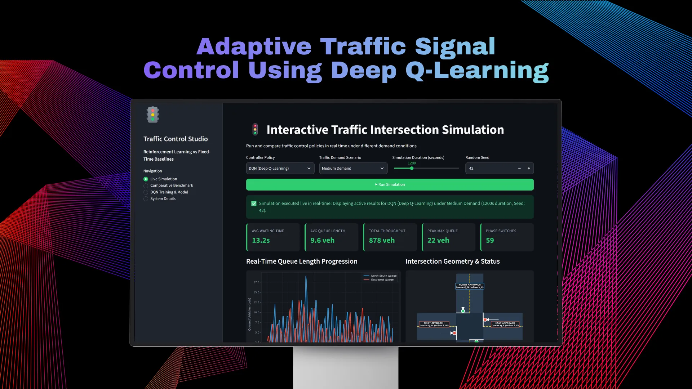


## Project Overview

Adaptive Traffic Signal Control Using Deep Q-Learning is a reinforcement learning research and engineering project that optimizes signal phase timing at a four-way urban intersection. Rather than relying on static pre-timed cycles or myopic threshold heuristics, a Deep Q-Network (DQN) agent interacts with a stochastic, physics-informed traffic simulation environment (`TrafficIntersectionEnv`) to minimize vehicle waiting time, queue accumulation, and directional congestion imbalance while strictly enforcing real-world signal safety constraints. The repository includes the complete simulation engine, PyTorch DQN training pipeline, matched-seed baseline benchmarking against Fixed-Time and Actuated controllers, publication-grade visualization tools, and an interactive dark-mode Streamlit studio.

## Problem Statement & Objectives

Conventional pre-timed traffic signal controllers operate on fixed green-time allocations derived from historical flow averages, which causes wasted green phases during off-peak hours and severe queue spillback during sudden directional surges. While vehicle-actuated controllers react to immediate loop-detector thresholds, they remain myopic and often struggle to balance competing corridors under rapidly shifting traffic demand.

The primary objectives of this project are:

- Formulate isolated four-way intersection signal control as a constrained Markov Decision Process (MDP) with a normalized 12-dimensional state space and binary phase-control action space.
- Simulate realistic stochastic vehicle arrivals using a Poisson arrival process with a continuous saturation discharge rate (`0.55 veh/s` per approach) and FIFO vehicle-level delay tracking.
- Enforce non-negotiable traffic safety constraints in environment dynamics, including a `10.0s` minimum green duration, a `4.0s` yellow clearance interval preventing conflicting green phases, and a `60.0s` maximum green cap to prevent starvation.
- Train a stabilized Deep Q-Network agent using experience replay, target network synchronization, LayerNorm-regularized MLP layers, Huber loss, and gradient norm clipping.
- Benchmark the learned policy across matched random seeds (`[100, 200, 300, 400, 500]`) against Fixed-Time and Actuated baselines under Low, Medium, High, and Dynamic Changing demand scenarios.
- Provide reproducible evaluation scripts, automated diagnostic plots, unit tests, and an interactive Streamlit dashboard (`streamlit/streamlit_app.py`).

## Data & Input Sources

No standalone static external dataset is used in this project; instead, training and evaluation data are dynamically generated through a stochastic Poisson traffic simulator ([`src/environment/traffic_generator.py`](src/environment/traffic_generator.py)) configured via [`config/default.yaml`](config/default.yaml). At each 1-second simulation tick across a 3,600-second episode horizon, discrete vehicle arrivals are sampled per approach (`north`, `south`, `east`, `west`) under four traffic demand regimes, while the environment outputs normalized observation tensors every 5-second decision step. Pre-generated simulation traces, training logs, and evaluation records are stored locally in [`metrics/`](metrics/) and [`simulations/`](simulations/).

| Attribute | Value / Source |
| :--- | :--- |
| Dataset / Input Source | Stochastic Poisson Traffic Generator (`TrafficGenerator`) & `TrafficIntersectionEnv` |
| Source Location | [`src/environment/traffic_generator.py`](src/environment/traffic_generator.py), [`config/default.yaml`](config/default.yaml) |
| Format | In-memory NumPy `float32` state vectors; persisted outputs in JSON and CSV |
| Simulation Scale | 100 training episodes (1 hr each, 72,000 decision steps) + 60 evaluation runs (5 seeds x 4 scenarios x 3 controllers) |
| Features / Input Shape | `12` continuous normalized features in `[0.0, 1.0]` per decision step |
| Target / Reward Signal | Scalar shaped penalty combining total queue length, mean waiting time, directional pressure, switch cost, and emergency queue penalty |

## Data Preprocessing & Feature Engineering

Because raw vehicle counts and accumulated waiting times vary dramatically between light off-peak traffic and oversaturated rush hours, [`TrafficIntersectionEnv._get_observation()`](src/environment/traffic_intersection.py) transforms raw simulator state into a bounded `[0.0, 1.0]` feature vector before neural network inference.

| Feature Indices | Input Signal | Transformation / Normalization | Output Range |
| :--- | :--- | :--- | :--- |
| `s[0..3]` | Approach queue lengths (`N, S, E, W`) | Clipped ratio `min(Q_a / 150.0, 1.0)` | `[0.0, 1.0]` |
| `s[4..7]` | Mean approach waiting times (`N, S, E, W`) | Clipped ratio `min(mean(W_a) / 180.0, 1.0)` | `[0.0, 1.0]` |
| `s[8]` | Active signal phase | Binary corridor indicator (`0.0` for NS, `1.0` for EW) | `{0.0, 1.0}` |
| `s[9]` | Elapsed phase duration | Clipped ratio `min(t_phase / 60.0, 1.0)` | `[0.0, 1.0]` |
| `s[10]` | Phase switch eligibility flag | `1.0` if in green phase and `t_phase >= 10.0s`, else `0.0` | `{0.0, 1.0}` |
| `s[11]` | Total intersection occupancy | Clipped ratio `min(sum(Q_a) / 300.0, 1.0)` | `[0.0, 1.0]` |

1. Individual vehicle objects accumulate waiting time at `1.0s` simulation ticks while queued in FIFO per-approach deques.
2. Every `5.0s` decision step, per-approach queue sizes and mean waiting times are computed and normalized against configured physical caps (`max_queue_capacity = 150`, `max_wait_norm = 180.0s`).
3. Signal timing flags (`s[8..10]`) and total network occupancy (`s[11]`) are appended to produce the final `np.float32` vector of shape `(12,)`.

## Tech Stack

| Category | Technology | Purpose |
| :--- | :--- | :--- |
| Language | Python | Core simulation, RL agent, evaluation, and application implementation |
| Deep Learning | PyTorch | `QNetwork` MLP definition, Smooth L1 (Huber) loss, Adam optimization, and `.pt` checkpointing |
| Numerical Computing | NumPy | Poisson arrival sampling, state normalization, replay buffer arrays, and summary statistics |
| Data Analysis | Pandas | Aggregating multi-seed evaluation tables and computing baseline improvement percentages |
| Scientific Computing | SciPy | Supporting numerical analysis dependencies declared in `requirements.txt` |
| Visualization | Matplotlib, Seaborn | Training curves, scenario comparison bars, time-series traces, Gantt timelines, and schematics |
| Configuration | PyYAML | Parsing simulation, reward, DQN, and baseline settings from `config/default.yaml` |
| Interactive UI | Streamlit | Dark-mode Traffic Control Studio web application for live simulation and visual diagnostics |
| Testing | Pytest | Unit and safety-invariant test suite covering environment, baselines, agent, and evaluation |

## Machine Learning Approach

Signal control is formulated as an episodic discrete-time Markov Decision Process (MDP) solved via off-policy value-based Deep Reinforcement Learning. At each `5.0s` decision interval, the agent observes the 12-dimensional intersection state, selects whether to maintain the active green phase (`Action 0`) or request a transition to the opposing corridor (`Action 1`), and receives a composite negative reward penalizing queue length, average waiting time, directional imbalance, phase switching, and severe queue spillback.

| Attribute | Implementation Detail |
| :--- | :--- |
| Learning Paradigm | Reinforcement Learning |
| Problem Domain | Urban Transportation & Adaptive Traffic Signal Control |
| ML Task | Sequential Decision-Making / Discrete Control Policy Optimization |
| Input Representation | 12-dimensional normalized intersection traffic and phase vector |
| Action / Output Space | Binary discrete control: `0` (Keep Current Phase), `1` (Switch Phase via 4s Clearance) |
| Reward Formulation | `-(0.04 * sum(Q) + 0.02 * mean(W) + 0.03 * |Q_NS - Q_EW|) - P_switch - P_emerg` |

## Model Overview

The control policy is parameterized by `QNetwork` ([`src/agents/network.py`](src/agents/network.py)), a Multi-Layer Perceptron trained from scratch within `DQNAgent` ([`src/agents/dqn_agent.py`](src/agents/dqn_agent.py)) using an online Q-network and a periodically synchronized target Q-network.

| Attribute | Specification |
| :--- | :--- |
| Model Name | `QNetwork` (Deep Q-Network Policy & Target Pair) |
| Architecture | `Linear(12 -> 128) -> LayerNorm -> ReLU -> Linear(128 -> 128) -> LayerNorm -> ReLU -> Linear(128 -> 2)` |
| Model Type | Value-Based Deep Reinforcement Learning (MLP Q-Function Approximator) |
| Framework | PyTorch (`torch.nn.Module`) |
| Pretrained Status | Trained from scratch in this project (no external pretrained weights) |
| Baseline Comparators | `FixedTimeController` (30s/30s pre-timed cycle) and `ActuatedController` (queue-ratio threshold) |

## ML Workflow

The end-to-end research and engineering workflow documented in [`final_report.md`](final_report.md) proceeds through the following verified stages:

1. **Configuration & Demand Definition**: Simulation physics, safety limits, reward weights, DQN hyperparameters, and scenario arrival rates are configured in [`config/default.yaml`](config/default.yaml).
2. **Traffic Simulation & Environment Dynamics**: [`TrafficGenerator`](src/environment/traffic_generator.py) generates stochastic Poisson vehicle arrivals while [`TrafficIntersectionEnv`](src/environment/traffic_intersection.py) executes 1-second queue/discharge updates, enforces `min_green_time`, `yellow_time`, and `max_green_time`, and exposes a Gymnasium-style `reset()` / `step()` API.
3. **DQN Agent Training & Validation Checkpointing**: [`src/training/train.py`](src/training/train.py) cycles across Medium, High, and Low demand episodes, stores transitions in a 50,000-capacity cyclic [`ReplayBuffer`](src/agents/replay_buffer.py), updates weights via Huber loss, and validates every 10 episodes across unseen seeds to checkpoint the lowest validation waiting-time model to [`models/best_dqn_model.pt`](models/best_dqn_model.pt).
4. **Matched-Seed Multi-Scenario Benchmarking**: [`src/evaluation/evaluate.py`](src/evaluation/evaluate.py) evaluates the saved DQN checkpoint (`evaluate=True`, greedy policy) alongside Fixed-Time and Actuated baselines across 5 matched seeds (`[100, 200, 300, 400, 500]`) and 4 scenarios (`low`, `medium`, `high`, `changing`), persisting outputs in [`metrics/`](metrics/) and [`simulations/simulation_traces.json`](simulations/simulation_traces.json).
5. **Diagnostic Visualization & Verification**: [`src/visualization/plots.py`](src/visualization/plots.py) generates training, comparison, time-series, and phase Gantt figures, while [`tests/`](tests/) validates environment safety invariants and agent mechanics.
6. **Interactive Visual Studio**: [`streamlit/streamlit_app.py`](streamlit/streamlit_app.py) serves a 4-view dark-mode dashboard for live simulation, benchmark inspection, training diagnostics, and MDP specification review.

## ML Pipeline Architecture

The pipeline connects stochastic arrival generation and safety-constrained intersection physics with the DQN training/evaluation loop and downstream reporting artifacts.

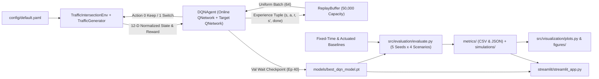

## Model Training & Configuration

The DQN agent was trained from scratch for `100` one-hour simulation episodes (`3,600s` per episode; `720` decision steps per episode; `72,000` total decision steps) with `seed=42`, rotating demand regimes (`medium`, `high`, `low`) to promote policy generalization. Every `10` episodes, deterministic greedy evaluation (`epsilon=0`) was run for `1,800s` on `medium` demand across unseen validation seeds (`[100, 200, 300, 400, 500]`), saving the checkpoint with the lowest validation average waiting time. Note that [`config/default.yaml`](config/default.yaml) sets `train_episodes: 120`, while the executed run recorded in [`models/training_metadata.json`](models/training_metadata.json) used `100` episodes (`--episodes 100`), completing in `191.10s`.

| Parameter | Verified Value | Role / Configuration Detail |
| :--- | :--- | :--- |
| State / Action Dimensions | `12` / `2` | 12 normalized features; binary Keep (`0`) / Switch (`1`) action |
| Hidden Layers | `[128, 128]` | Two fully connected layers with `LayerNorm` and `ReLU` |
| Optimizer | Adam (`lr = 0.0005`) | Online Q-network parameter updates |
| Objective Criterion | Smooth L1 Loss (Huber) | `nn.SmoothL1Loss()` with gradient norm clipping (`max_norm = 5.0`) |
| Discount Factor (`gamma`) | `0.99` | Long-horizon delay and queue minimization |
| Exploration Schedule | Linear `1.0 -> 0.05` | Decays over `10,000` decision steps; greedy (`0.0`) at evaluation |
| Replay Buffer & Batch Size | `50,000` / `64` | Cyclic FIFO NumPy buffer with uniform random sampling |
| Target Network Sync | Hard update every `400` steps | `use_soft_update: false` (`tau: 0.005` configured if soft mode enabled) |
| Safety Constraints | Min `10s`, Max `60s`, Yellow `4s` | Decision step `5.0s`, simulation tick `1.0s`, saturation `0.55 veh/s` |
| Best Validation Checkpoint | Episode `40` (`13.99s` val wait) | Saved to [`models/best_dqn_model.pt`](models/best_dqn_model.pt) |

```bash
python -m src.training.train --config config/default.yaml --episodes 100
```

## Model Comparison & Selection

To establish rigorous performance baselines, the Episode 40 DQN checkpoint is evaluated under identical random seeds (`[100, 200, 300, 400, 500]`) and identical intersection physics against two classical signal controllers implemented in [`src/baselines/fixed_time_controller.py`](src/baselines/fixed_time_controller.py). Across balanced, shifting, and peak traffic regimes, DQN demonstrates superior adaptability in Medium and Dynamic Changing demand, while revealing throughput-delay trade-offs under extreme oversaturation (`High` demand).

| Controller | Selection / Timing Logic | Strengths Observed | Limitations Observed |
| :--- | :--- | :--- | :--- |
| `FixedTimeController` | Rigid `30s` NS Green / `4s` Yellow / `30s` EW Green / `4s` Yellow (`68s` cycle) | Minimal phase switches (`102.0` per hr) and predictable clearance loss | Severe queue accumulation (`272.2` peak vehicles) during directional rush surges |
| `ActuatedController` | Switches after `10s` min green if active queue clears or opposing queue exceeds threshold (`1.5x` in `config/default.yaml`; `1.3x` class default) | Lowest waiting time in Low demand (`7.81s`) and highest High-demand throughput (`3,670.8 veh`) | Reactive myopic switching; `25.0%` higher wait time than DQN in Dynamic Changing demand (`33.93s` vs `27.06s`) |
| `DQNAgent` (Selected) | Greedy Q-value maximization over 12-D state vector (`models/best_dqn_model.pt`) | Lowest waiting time in Medium (`14.51s`), High (`419.92s`), and Dynamic Changing (`27.06s`, `-83.7%` vs Fixed-Time) | Higher phase switching (`146.2` vs `102.0`) reduces raw throughput by `5.0%` during oversaturated High demand |

## Model Artifacts & Checkpoints

All serialized model weights, training telemetry, and evaluation outputs produced during training and benchmarking are preserved in the repository (note that `src/training/train.py` and `src/evaluation/evaluate.py` default to `results/metrics/` and `results/simulations/` at runtime, whereas verified outputs in this repository are organized directly under [`metrics/`](metrics/), [`simulations/`](simulations/), and [`figures/`](figures/)).

| Artifact | Format | Purpose | Repository Location |
| :--- | :--- | :--- | :--- |
| `best_dqn_model.pt` | PyTorch Checkpoint (`.pt`) | Best Episode 40 policy/target state dicts, optimizer state, and validation metadata | [`models/best_dqn_model.pt`](models/best_dqn_model.pt) |
| `training_metadata.json` | JSON | Training run summary (`100` episodes, `13.99s` best val wait, `191.10s` runtime, `seed=42`) | [`models/training_metadata.json`](models/training_metadata.json) |
| `training_history.json` | JSON | Per-episode reward, Huber loss, epsilon, waiting time, queue, and 10-ep validation logs | [`metrics/training_history.json`](metrics/training_history.json) |
| `evaluation_summary.csv` | CSV | Aggregated mean and standard deviation metrics across 60 evaluation runs | [`metrics/evaluation_summary.csv`](metrics/evaluation_summary.csv) |
| `evaluation_improvements.csv` | CSV | Relative percentage changes of DQN versus Fixed-Time baseline per scenario | [`metrics/evaluation_improvements.csv`](metrics/evaluation_improvements.csv) |
| `evaluation_detailed.json` | JSON | Raw per-seed, per-scenario metrics for all 60 simulation runs | [`metrics/evaluation_detailed.json`](metrics/evaluation_detailed.json) |
| `simulation_traces.json` | JSON | Second-by-second queue, phase, departure, and wait traces for Seed 100 visualizations | [`simulations/simulation_traces.json`](simulations/simulation_traces.json) |

## Model Evaluation & Results

Evaluation was performed across `60` independent 1-hour (`3,600s`) test runs covering `4` demand scenarios (`low`, `medium`, `high`, `changing`) x `5` matched random seeds (`100, 200, 300, 400, 500`) x `3` controllers, distinct from the `seed=42` training environment. Reported values below come directly from [`metrics/evaluation_summary.csv`](metrics/evaluation_summary.csv) and [`metrics/evaluation_improvements.csv`](metrics/evaluation_improvements.csv).

| Scenario | Controller | Avg Waiting Time (s) | Avg Queue Length (veh) | Throughput (veh/hr) | Peak Max Queue (veh) | DQN Change vs Fixed-Time (Wait / Queue) |
| :--- | :--- | :---: | :---: | :---: | :---: | :---: |
| **Low Demand** | Fixed-Time | `13.54 +/- 0.42` | `4.59 +/- 0.24` | `1,226.8` | `17.0` | — |
| **Low Demand** | Actuated | `7.81 +/- 0.48` | `2.52 +/- 0.15` | `1,229.0` | `10.4` | — |
| **Low Demand** | **DQN (Proposed)** | `9.21 +/- 0.29` | `3.05 +/- 0.09` | `1,228.6` | `10.8` | `-32.0%` / `-33.4%` |
| **Medium Demand** | Fixed-Time | `25.40 +/- 5.34` | `18.90 +/- 4.14` | `2,668.8` | `45.0` | — |
| **Medium Demand** | Actuated | `17.87 +/- 2.41` | `13.21 +/- 1.89` | `2,671.2` | `33.8` | — |
| **Medium Demand** | **DQN (Proposed)** | `14.51 +/- 1.22` | `10.74 +/- 0.98` | `2,672.2` | `29.2` | `-42.9%` / `-43.2%` |
| **High Demand** | Fixed-Time | `490.79 +/- 26.12` | `689.19 +/- 39.80` | `3,488.8` | `1,383.4` | — |
| **High Demand** | Actuated | `444.66 +/- 31.09` | `602.91 +/- 41.36` | `3,670.8` | `1,201.4` | — |
| **High Demand** | **DQN (Proposed)** | `419.92 +/- 34.36` | `749.18 +/- 63.91` | `3,313.4` | `1,558.4` | `-14.4%` / `+8.7%` |
| **Dynamic Changing** | Fixed-Time | `166.39 +/- 9.79` | `120.66 +/- 9.35` | `2,608.8` | `272.2` | — |
| **Dynamic Changing** | Actuated | `33.93 +/- 7.22` | `24.60 +/- 5.82` | `2,612.0` | `68.6` | — |
| **Dynamic Changing** | **DQN (Proposed)** | `27.06 +/- 8.88` | `19.67 +/- 6.94` | `2,610.6` | `58.0` | `-83.7%` / `-83.7%` |

- **Training Convergence**: Over 100 training episodes, episode reward rose from `-4,251.1` (Episode 1) to `-726.3` (Episode 10) and stabilized near `-600` to `-700`, while training waiting time dropped to a minimum of `13.85s` at Episode 86; validation across unseen seeds peaked at Episode 40 (`13.99s`).
- **Dynamic Surge Resilience**: Under time-varying directional rush hours (`changing`), DQN reduced total accumulated delay by `83.7%` (`70,986.6 veh-s` vs `434,404.8 veh-s` for Fixed-Time) and cut peak queue spillback by `78.7%` (`58.0` vs `272.2` vehicles).
- **Oversaturation Boundary Condition**: Under High demand (`~4,896 veh/hr` inflow exceeding the intersection's `~3,960 veh/hr` maximum discharge capacity), DQN lowered average waiting time by `14.4%` (`419.92s` vs `490.79s`) and total delay by `18.8%`, but incurred a `5.0%` throughput trade-off (`3,313.4` vs `3,488.8 veh/hr`) due to more frequent `4s` clearance switches (`146.2` vs `102.0`).

## Results Visualization & Preview

### 1. Interactive Live Traffic Intersection Simulation Dashboard
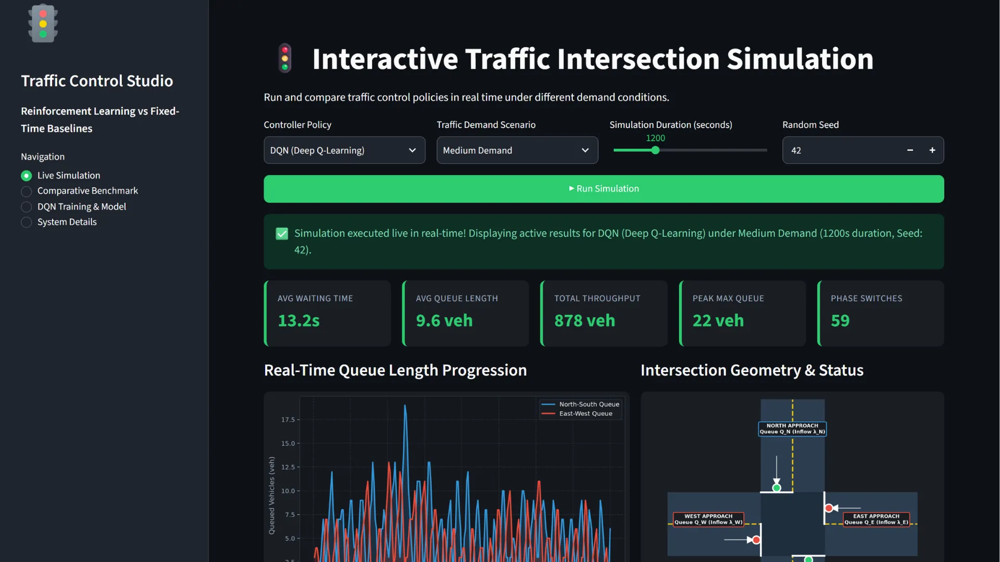
The Live Simulation view in the dark-mode Streamlit Traffic Control Studio (`streamlit/streamlit_app.py`), demonstrating a real-time 1,200-second Medium Demand run (`Seed 42`) with the trained DQN controller achieving `13.2s` average waiting time, `9.6 veh` average queue length, `878 veh` throughput, and live North-South vs East-West queue progression alongside the 4-way intersection schematic.

### 2. Multi-Seed Empirical Benchmark & Improvement Summary Tables
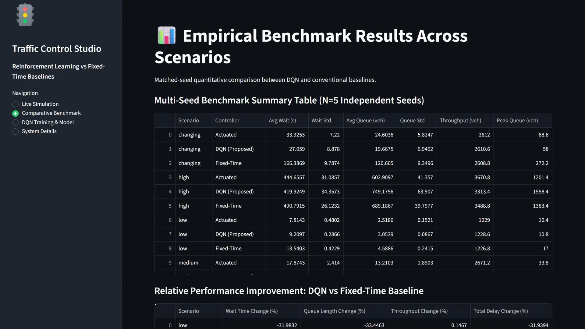
The Comparative Benchmark view presenting the aggregated `N=5` seed summary table and relative percentage change table across `changing`, `high`, `low`, and `medium` demand regimes, highlighting DQN's `-83.74%` waiting time and `-83.70%` queue length reductions under Dynamic Changing traffic.

### 3. DQN Training Convergence & Optimization Dashboard
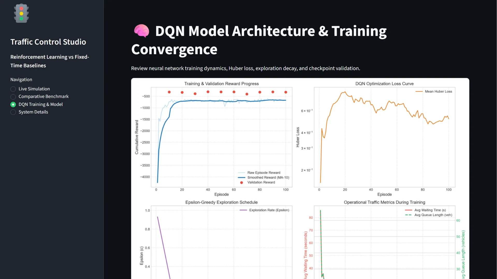
The DQN Training & Model dashboard view displaying the 4-panel training diagnostic suite—smoothed episode reward with validation checkpoints, Smooth L1 (Huber) optimization loss, linear epsilon-greedy exploration decay, and training-time operational waiting and queue curves.

### 4. MDP Formulation, Safety Constraints & Signal Phase Timeline
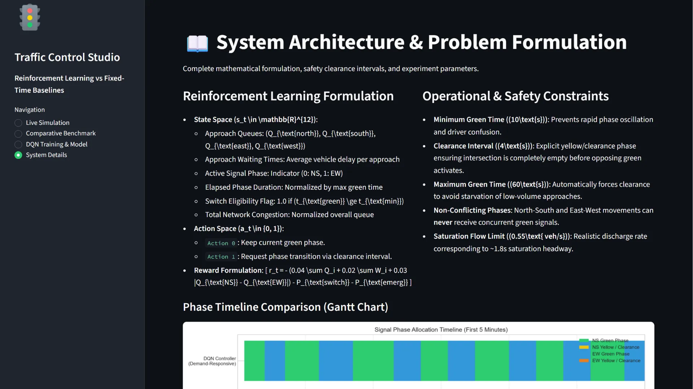
The System Details interface documenting the 12-dimensional state vector, binary action space, composite reward function, operational safety constraints (`10s` min green, `4s` clearance, `60s` max green, `0.55 veh/s` saturation flow), and the first-5-minute demand-responsive phase Gantt chart.

### 5. Queue Length Time-Series Under Dynamic Changing Demand
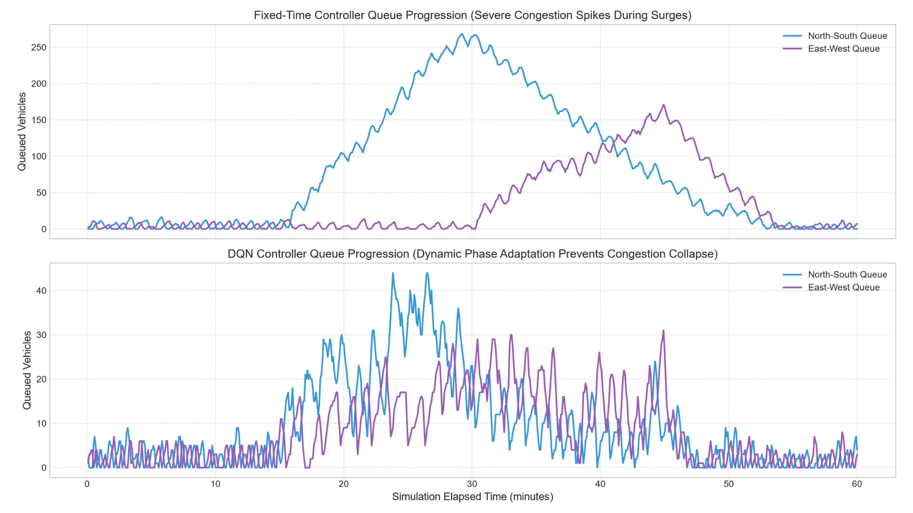
Second-by-second queue progression comparing Fixed-Time control (top) against DQN control (bottom) over a 60-minute directional surge episode, showing Fixed-Time collapsing past 250 queued vehicles during rush shifts while DQN dynamically extends active green phases to keep corridor queues under 45 vehicles.

### 6. Four-Panel DQN Training & Validation Curves
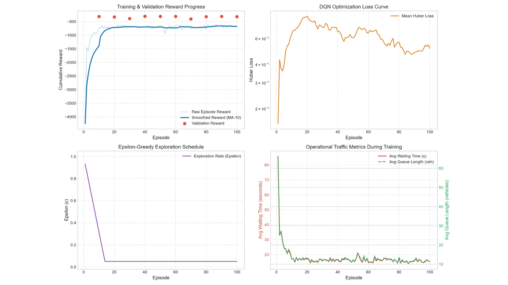
Detailed training telemetry across 100 episodes illustrating rapid reward convergence after Episode 10, validation reward consistency across 10-episode checkpoints (selecting Episode 40 at `13.99s`), Huber loss stabilization around `0.48–0.52`, epsilon decay to `0.05` over 10,000 steps, and operational delay dropping from `85.8s` to `<15s`.

### 7. Relative Performance Gains & Signal Phase Allocation Gantt Timeline
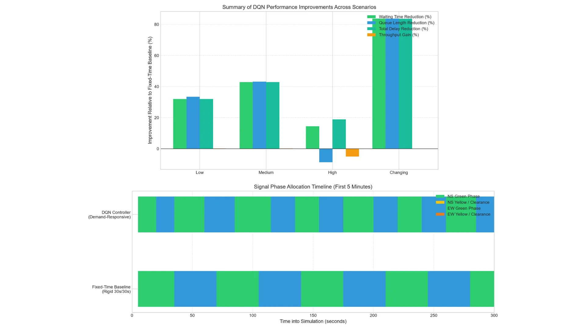
Composite evaluation visualization pairing scenario-wise percentage improvements relative to the Fixed-Time baseline (top) with the 300-second Signal Phase Allocation Gantt chart (bottom), demonstrating how variable-length DQN green phases eliminate wasted clearance cycles compared to rigid `30s/30s` fixed splits.

### 8. Scenario-Wise Throughput, Queue Length & Waiting Time Benchmarks
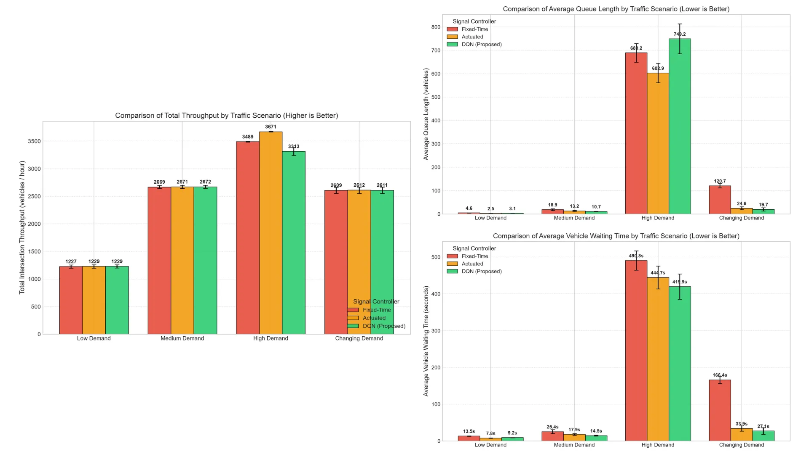
Three-panel bar comparison with `N=5` error bars contrasting Fixed-Time, Actuated, and DQN controllers across all four demand regimes, confirming near-100% arrival clearance under Low, Medium, and Changing demand with substantially lower waiting times and queue lengths for DQN.

### 9. Total Accumulated Delay & Maximum Queue Spillback Risk
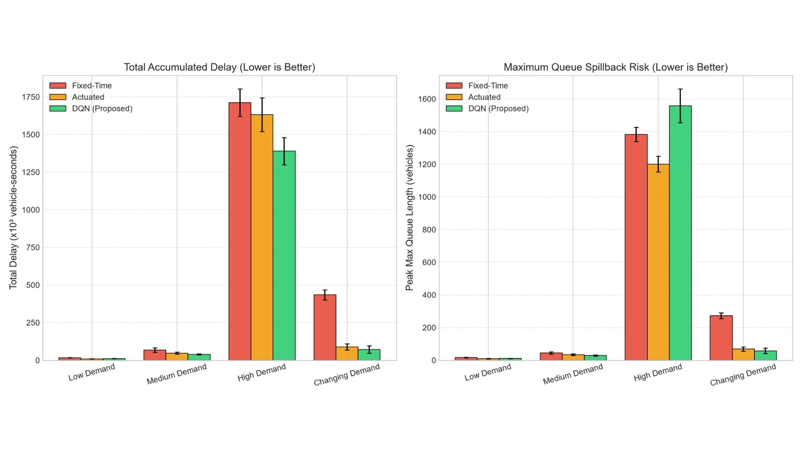
Comparative bar charts with standard-deviation error bars illustrating total accumulated delay (`x10^3 vehicle-seconds`) and peak maximum queue length (`vehicles`), verifying an `83.7%` delay reduction and `78.7%` peak spillback reduction for DQN in Dynamic Changing demand.

## Prerequisites

- **Operating System**: Windows, macOS, or Linux with Python 3.9+ installed.
- **Python Dependencies** (from [`requirements.txt`](requirements.txt)): `numpy>=1.24.0`, `torch>=2.0.0`, `pyyaml>=6.0`, `matplotlib>=3.7.0`, `seaborn>=0.12.0`, `pandas>=2.0.0`, `scipy>=1.10.0`, `pytest>=7.0.0`, `streamlit>=1.30.0`.
- **Compute Hardware**: Runs natively on CPU (`DQNAgent` automatically selects CUDA if available, with full CPU support for both training and inference; the 100-episode training run completed in `191.10s`).
- **Pretrained / External Model Access**: Not required; all weights (`models/best_dqn_model.pt`) and simulation modules are self-contained in the repository.

## Installation & Setup

1. Clone the repository and enter the project directory:
   ```bash
   git clone https://github.com/weztcy/Adaptive-Traffic-Signal-Control-Using-Deep-Q-Learning.git
   cd "Adaptive Traffic Signal Control Using Deep Q-Learning"
   ```

2. Create and activate a virtual environment:
   ```bash
   python -m venv .venv
   # Windows PowerShell:
   .venv\Scripts\Activate.ps1
   # macOS / Linux:
   source .venv/bin/activate
   ```

3. Install required packages from [`requirements.txt`](requirements.txt):
   ```bash
   python -m pip install -r requirements.txt
   ```

4. Verify the installation and environment safety invariants using Pytest:
   ```bash
   python -m pytest -v
   ```

## Usage & Execution

Once dependencies are installed, you can run inference/evaluation on the saved checkpoint, inspect figures, or launch the interactive Streamlit dashboard:

1. **Run the Interactive Streamlit Dashboard**:
   ```bash
   streamlit run streamlit/streamlit_app.py
   ```
   *(Note: If running from the repository root, ensure `metrics/`, `figures/`, and `simulations/` paths expected by `streamlit/streamlit_app.py` under `results/` are aligned if you regenerate fresh artifacts, or run evaluation first to populate `results/`.)*

2. **Evaluate Controllers Against Baselines** using the saved checkpoint [`models/best_dqn_model.pt`](models/best_dqn_model.pt):
   ```bash
   python -m src.evaluation.evaluate --config config/default.yaml --model models/best_dqn_model.pt
   ```

3. **Generate Publication Figures**:
   ```bash
   python -m src.visualization.plots
   ```

4. **Run the Unit & Safety Test Suite**:
   ```bash
   python -m pytest -v
   ```

## Reproducibility & Execution

Training and evaluation are deterministic up to PyTorch/NumPy seeded RNG behavior (`seed: 42` for training in `src/training/train.py`, and `eval_seeds: [100, 200, 300, 400, 500]` in [`config/default.yaml`](config/default.yaml)). Because `config/default.yaml` currently lists `train_episodes: 120`, reproduce the exact documented 100-episode benchmark run recorded in [`models/training_metadata.json`](models/training_metadata.json) by passing `--episodes 100`:

1. **Reproduce the 100-Episode DQN Training Run** (writes checkpoint to `models/best_dqn_model.pt` and history to `results/metrics/training_history.json`):
   ```bash
   python -m src.training.train --config config/default.yaml --episodes 100
   ```
   *(For a quick 5-episode functional verification, run `python -m src.training.train --smoke-test`.)*

2. **Reproduce Multi-Seed Evaluation Across All 4 Scenarios** (60 total runs across seeds `100, 200, 300, 400, 500`):
   ```bash
   python -m src.evaluation.evaluate --config config/default.yaml --model models/best_dqn_model.pt
   ```

3. **Reproduce All Diagnostic Plots** from training history and evaluation outputs:
   ```bash
   python -m src.visualization.plots
   ```

4. **Reproducibility Caveats**: Exact floating-point parity across hardware architectures (CPU vs GPU) is not guaranteed by default PyTorch operations without deterministic cuDNN flags, and the repository currently stores historical outputs in top-level [`metrics/`](metrics/), [`figures/`](figures/), and [`simulations/`](simulations/) rather than `results/`.

## Contributing

Contributions to improve the traffic simulation fidelity, reinforcement learning algorithms, or visualization tooling are welcome. Please follow these steps when submitting changes:

1. Fork the repository.
2. Create a feature branch for your change (`git checkout -b feature/your-feature`).
3. Implement your changes cleanly with docstrings and inline comments where non-obvious.
4. Run the Pytest suite (`python -m pytest -v`) to verify all safety constraints and agent tests pass.
5. Commit and push your branch to your fork.
6. Open a pull request with a clear explanation of the changes and observed test results.

## License

This project is licensed under the MIT License.
See the [LICENSE](LICENSE) file for details.

## Author & Contact

**Yohanes Dimas Pratama**

- GitHub: [github.com/weztcy](https://github.com/weztcy)
- Portfolio: [yohanesdimas.com](https://yohanesdimas.com)
- LinkedIn: [linkedin.com/in/yohanes-dimas](https://www.linkedin.com/in/yohanes-dimas)
